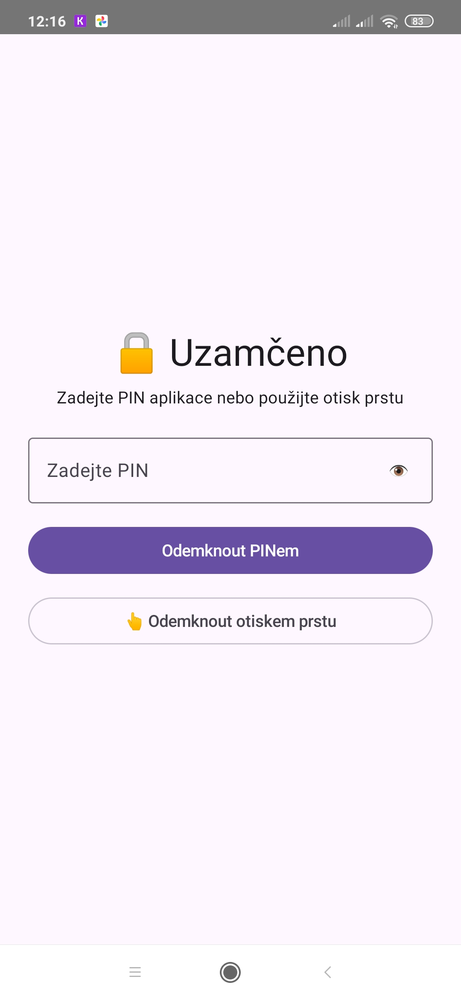
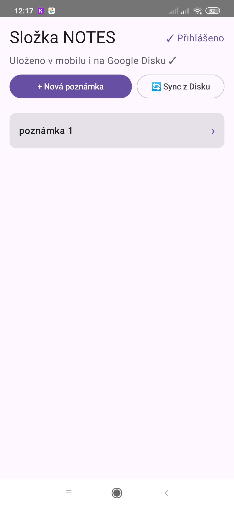
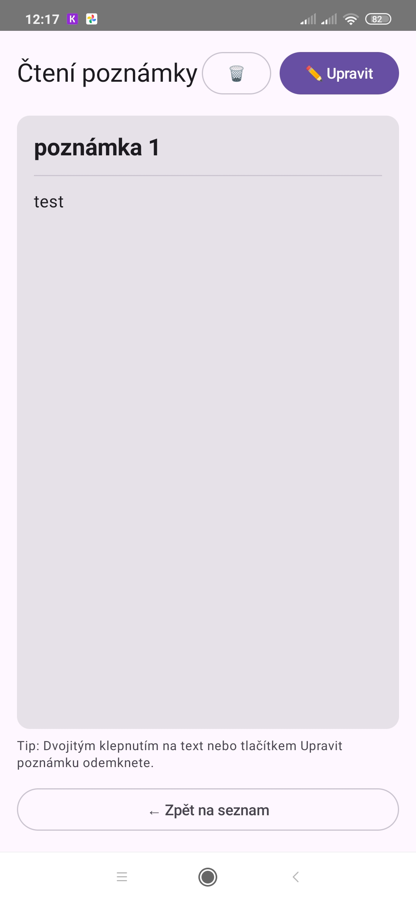

# NOTES – testovací verze pro Android

Jednoduchý a zabezpečený poznámkový blok s šifrovaným offline úložištěm a synchronizací na Google Disk.

## 📥 Stažení a instalace
👉 **[Stáhnout aplikaci (notes.apk)](https://github.com/mirostep/notes/raw/main/notes.apk)**

1. Klepněte na odkaz výše a stáhněte soubor `notes.apk`.
2. Otevřete stažený soubor v mobilu. Pokud systém zobrazí varování před neznámým zdrojem, povolte v nastavení instalaci z prohlížeče.

## 💡 Jak aplikaci ovládat
* **Zabezpečení:** Při prvním spuštění si nastavte vlastní číselný PIN (min. 4 číslice). Poté lze odemykat i otiskem prstu.
* **Offline režim:** Poznámky se ukládají zašifrované přímo v mobilu, fungují i bez internetu.
* **Úprava a smazání:** Otevřená poznámka je jen ke čtení – upravíte ji **dvojitým poklepáním na text** nebo tlačítkem **Upravit** vpravo nahoře.
* **Google Disk:** Pro zálohu a synchronizaci do složky `NOTES` na vašem Disku klepněte na **Přihlásit**.

## 📱 Ukázky aplikace

  
  
  

